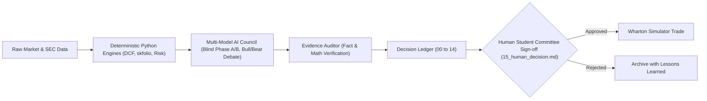

# Wharton Global High School Investment Competition: AI Use Disclosure and Governance Policy

## 1. Compliance Statement & Ethics Standard
This document formalizes the AI ethics, transparency, and attribution guidelines for our team's participation in the 2026–2027 Wharton Global High School Investment Competition.

Wharton's competition rules require that all Investment Policy Statements (IPS), Trade Rationales, and Final Strategy Reports represent the original, independent work and critical thinking of high school team members.

In strict compliance with Wharton guidelines:
- **No Direct AI-Generated Submissions**: Language models are strictly forbidden from authoring prose intended to be submitted directly as student report text.
- **Decision-Support Architecture Only**: AI is utilized strictly within `wharton-ic` as a computational and adversarial decision-support assistant—challenging student assumptions, synthesizing independent bull/bear cases, auditing numerical claims, and structuring evidence.
- **Human Sovereign Gate**: No investment decision, portfolio rebalance, or trade execution can be approved autonomously. Every action requires a student investment committee review and signature in the immutable decision ledger (`15_human_decision.md`).

---

## 2. Technical Safeguards Enforced by `wharton-ic`

1. **Principle A: Numbers from Code; Reasoning from Models**
   - Language models are hard-coded to never calculate authoritative financial arithmetic, portfolio weights, DCF formulas, WACC rates, volatility, or backtest returns.
   - Vectorized, audited Python libraries (`skfolio`, `scipy`, `pandas`, `cvxpy`, `statsmodels`) perform 100% of numerical calculations.

2. **Principle B: Zero Look-Ahead Leakage**
   - Point-in-time stores enforce strict filing date cutoffs (`filing_date <= as_of_date`). No agent or backtest can access future data.

3. **Principle C: Machine-Readable Provenance & Audit Trail**
   - Every LLM interaction is logged automatically in `toolkit/outputs/ai_use_log.jsonl` with exact timestamp, provider, model name, prompt version, and role.
   - The Evidence Auditor classifies all assertions into `[VERIFIED FACT]`, `[VERIFIED CALCULATION]`, and `[INFERENCE]`, preventing ungrounded hallucinations.

---

## 3. Human-in-the-Loop Workflow

---

## 4. Disclosure for Final Report Appendix

Statement: **PENDING (team to write).** The draft statement that stood here until 2026-10-20 was removed because
the log below does not support it (it said all report narratives were "authored 100% by student team members").
The team writes its own Final Report disclosure, in its own words, from the log in section 5 once the Final Report
instructions are out (9 Nov ET). Until then, nothing in this file is a disclosure to Wharton.

---

## 5. AI Contribution Log

Substantive AI contributions, newest last. Each entry: date, tool, what the AI did, what the students decided.

Note (2026-10-20): an AI-prepared draft register of AI use from 25 Aug to 20 Oct 2026 (built from git history, pull
requests and Drive edit times; kept outside this repo, in the assistant's 20 Oct review files as
`oct20/ailog/ai_use_register.md`) exists for the team to check. It adds no rows here.

| Date (AEST) | Tool | What the AI did | Output | Student decision |
|---|---|---|---|---|
| 2026-09-29 | Claude Code (Claude Opus 5.5) | Checked a GPT (GPT-Astra, high effort) calculation of the Treasury ladder cost on the 28 Sep 2026 par curve: re-ran its code (same result: $289,003 today, $292,214 forward to 1 Jan 2027, breakeven fall 26.9bp) and estimated a 25-33% chance of a fall that large by January at 80-120bp annual rate volatility (normal approximation, ASSUMPTION). Par yields were supplied in the prompt, not yet checked against treasury.gov. | Chat analysis only | None yet |
| 2026-09-29 | Claude Code (Claude Opus 5.5) | Ran smaller-floor variants of the recommended design (2028 floor $150k/125k/100k/75k/50k/0) on the E4/E6 engine (same seed, 200,000 paths, JPM and Vanguard-like inputs, 93 history windows since 1928) to test the "reads as timid" critique. Result: each $25k less floor adds about $2-3k to the median 2033 total and costs about $9-10k at the 5th percentile and about $15k in the worst history window; under the Vanguard-like input the median does not rise. MODEL outputs, not forecasts. | `keel/library/insight_v1/scripts/F1_floor_variants.py` | Pending team vote (D2/D6); AI recommended keeping the $150k floor |
| 2026-09-29 | Claude Code (Claude Opus 5.5) | Re-ran the D1 ladder pricing (`D1_purchase_rule.py`) on the Treasury par curve for 28 Sep 2026, downloaded from home.treasury.gov (this checks the par yields used in the GPT row above). Result: $292,418 forward to 1 Jan 2027, $7,582 headroom, 26bp break-even, 24.2% model chance of a gap by January (was $294,387 / 19bp on 25 Sep). Wrote the brief for the independent GPT check and entered it in ChatGPT; reconciled the two results (the $204 gap is day count plus short-end nodes). MODEL outputs. | `keel/library/insight_v1/verification/ladder_2026-09-28/` (README, reconcile.py, curve CSV, D1 output) | None yet |
| 2026-09-29 | ChatGPT (GPT-6 Astra, high effort) | Independently bootstrapped the 28 Sep 2026 par curve and priced the same ladder from a blind brief (it did not see our answer): $289,003 today, $292,214 forward, 26.9bp break-even; alternative interpolation $290,965 / 31.2bp. | `keel/library/insight_v1/verification/ladder_2026-09-28/gpt/` (code and rung prices, copied unchanged) | None yet |
| 2026-09-29 | Claude Code (Claude Opus 5.5) | Researched public sources on why Wharton runs the competition and on past finalists/winners (2019-20 to 2025-26), and drafted a self-scoresheet from the official 2026-27 Guide, IPS and Trading Note instructions. | `Knox Wharton 2026/Winning Team Portrait and Scoresheet.md` (Google Drive) | None yet |
| 2026-09-29 | Claude Code (Claude Opus 5.5), with 10 Claude sub-agent reviewers | Wrote an EXEMPLAR IPS (pitch + IPS) at the team leader's request, for reference only, not for submission. Stress-tested it in two batteries (judge roast, pre-mortem, client/co-sponsor, fact and theory audit, rival red team; then FMEA, devil's advocate, key assumptions check, backcasting) plus a final cold read, all grounded in the official case, instructions, guide and rules page. Style modelled on CFA Institute IPS elements, NBIM, Oaktree and Penn Wharton Budget Model writing. Produced v3 (pitch 46 words, IPS 488; Word paginates to 3 pages). | `Caplet Investments/AI Outputs/IPS Exemplar v3 (AI, not for submission).docx` (Drive) | Team writes its own IPS in its own words; D6 share still pending |
| 2026-09-29 | Claude Code (Claude Opus 5.5), with 9 further Claude sub-agent reviewers | Rewrote the exemplar IPS to remove AI-style patterns (measured with a script: colons/semicolons, slogan sentences, parallel pairs, contrast framing), then stress-tested v4-v6 against the five official criteria with three judge personas (Wharton FNCE 2050 student, LDI portfolio manager, Wharton Global Youth evaluator), an AI-voice detector and fact-regression checks. Final v7: pitch 47 words, IPS 489; panel ~37/50; Word paginates to 3 pages. Trade-off figures from F1_floor_variants.py (JPM 2026 LTCMA). | `Caplet Investments/AI Outputs/IPS Exemplar v7 (AI, not for submission).docx` (Drive) | Exemplar only; team writes its own IPS |
| 2026-09-29 | Claude Code (Claude Opus 5.5), with further Claude sub-agent reviewers | Reworked the exemplar IPS (v8-v12) into a CFA-style policy register after reading real IPS documents (CFA Institute model passages, Oklahoma TRS IPS, UC Regents IPS) and investor letters (Oaktree, Berkshire); added liability-driven terminology; removed a detailed percentile calculation to follow the IPS instruction on calculations. Tested with three blind voice tests against human IPS passages (AI draft still rated ~60% likely AI vs 5-15% for human text), a strict compliance audit and judge panels (~36-37.5/50). | `Caplet Investments/AI Outputs/IPS Exemplar v12 (AI, not for submission).docx` (Drive) | Exemplar only; students must rewrite in their own words |
| 2026-09-30 | Claude Code (Claude Opus 5.5), RAB Kit WS6-notes | Wrote a brief and an **EXAMPLE note (labelled "EXAMPLE - team rewrites")** for every Friday WInS ticket in both books, the Friday swap variants and each October trigger (20 exemplars, each 284 characters or fewer, checked for banned words and number sources against `archive/rab/numbers.yaml`); recommended the three notes to feature in the Trading Notes Analysis (IBTM, the 4.500% May 2038 bond, VT) with bullet-point reflection outlines; built `note_check.py`, which measures a team draft's phrase overlap with each exemplar. Re-read the iShares product list (30 Sep): no iBonds Treasury fund ends Dec 2037 to Dec 2043. | `archive/rab/trades/notes.md`, `notes.csv`, `note_check.py`, `note_rules.py`, `build_notes.py` (branch rab/ws6) | None yet. Students write every note and reflection. If any exemplar wording is kept, the Final Report's Works Cited must disclose it; record here which exemplars each writer read. |
| 2026-09-30 | Claude Code (Claude Opus 5.5), RAB Kit WS6-notes (retry) | Revised four EXAMPLE notes (labelled "EXAMPLE - team rewrites"): IBTR and VT no longer imply an order of WInS trades that the Friday sequence contradicts (VT was then order 6 of 11, before the five bonds; corrected 30 Sep at Gate D: since round 2 VT is order 11, placed Mon 5 Oct ET after the five bonds fill), T38 now gives both reasons for the bond (last Treasury maturing before the 2039 payment; price check), T40 says "main unknown" not "main risk". Rewrote the Trading Notes Analysis reflection outlines around the TN guide's three questions, each 100 words or fewer, and added outlines for the two alternates. Every quoted IPS sentence is now checked against a 30 Sep text snapshot of the IPS doc (read-only). | `archive/rab/trades/notes.md`, `notes.csv`, `build_notes.py`, `data/ips_doc_text_2026-09-30.txt` (branch rab/ws6) | None yet. Same rule: students write every note and reflection; any exemplar wording kept is disclosed in the Final Report's Works Cited. |
| 2026-09-30 | Claude Code (Claude Opus 5.5), RAB Kit WS5 | Built a 20-item literature base for Root-and-Branch (LDI/dedicated bonds, safety-first/CPPI, goals-based investing, market-cap equity, nominal vs TIPS, communicating uncertainty). Every DOI resolved via doi.org and metadata taken from Crossref; each entry states whether the abstract/full text was read (A) or only a secondary source (S). Summaries and plan links are AI-written; team must read S-graded papers before quoting them. | `archive/rab/literature/references.md`, `references.bib`, `verify_dois.py` | None yet |
| 2026-09-30 | Claude Code (Claude Opus 5.5), RAB Kit WS1-WS4 | Built and cross-checked the models behind the kit: the ladder pricer and locked number registry (WS1, four pricers agreeing to the cent), the 2031 range and cap-share model, the century backtest, rivals and stress tests, and the pre-2027 rate-path model, each rebuilt blind for Gate B. MODEL outputs, not forecasts. | `archive/rab/models/`, `archive/rab/numbers.yaml` (locked, sha256 492ed320...), `archive/rab/numbers_ws2.yaml`, `numbers_ws3.yaml`, `numbers_ws4.yaml`, `archive/rab/gates/` | None yet |
| 2026-09-30 | Claude Code (Claude Opus 5.5), RAB Kit WS2/WS3/WS4 | Wrote decision memos for the team to ratify: D6 cap share (keep half; who pays a coupon shortfall), 2031 range confidence, three IPS assumptions, fund choice (keep VT), rivals (keep Root-and-Branch), bad-year stress rules, pre-2027 rate hedge (do not hedge). Each labels its triage (fix-before-6-Nov / Final Report / ignore); none edits the IPS. | `archive/rab/decisions/*.md` | Pending: D6 at the 26 Oct meeting; the rest before 6 Nov |
| 2026-09-30 | Claude Code (Claude Opus 5.5), RAB Kit WS6 | Wrote the Friday trade tickets for both books (quantities, max prices, cash after each order, 2x-volume check), the refresh script that re-sizes them from the prices the team types on Friday, the Friday runbook and the October second-trade rule. Suggestions only: students place every order. | `archive/rab/trades/tickets.md`, `tickets.csv`, `refresh_tickets.py`, `friday_checklist.md`, `october_trade.md`, `M9_selection.md` | Pending: 1 Oct vote (book, swap rule, roles) |
| 2026-09-30 | Claude Code (Claude Opus 5.5), RAB Kit WS6 rounds 2-3 | Revised the notes kit after three AI judge panels (commits 104476c, cc887b3, ef8aaf6): 23 **EXAMPLE notes (labelled "EXAMPLE - team rewrites")**, up to 294 characters; 17 of 23 rewritten; picks now IBTR (tested), a refined bond swap if one exists, VT (supported); reflection outlines; `judge_response.md` records each point. | `archive/rab/trades/notes.md`, `notes.csv`, `build_notes.py`, `note_rules.py`, `judge_response.md` | None yet. Students write every note and reflection; any exemplar wording kept is disclosed in Works Cited |
| 2026-09-30 | Claude Code (Claude Opus 5.5), RAB Kit WS6-sheets | Wrote two new tabs into the team Sheet, "RAB Tickets" (tickets with live cost and cash formulas) and "RAB Notes" (briefs, EXAMPLE notes, an empty Team note column with a live character count), via the Sheets connector (commit 0141438, then two live rewrites from the committed mirrors). No other tab was edited. | Sheet tabs "RAB Tickets", "RAB Notes"; mirrors `archive/rab/sheets/` | None yet |
| 2026-09-30 | Claude Code (Claude Opus 5.5), RAB Kit WS7 | Red-teamed the kit read-only: three-judge panels scoring the notes and picks against the self-scoresheet, a devil's advocate on each decision, a key-assumptions challenge and a fact audit. Then (Gate D) fixed the fix-now items: IBTR's EXAMPLE note now names its fund, IBTP's ends on the dated fact, the 1 Oct vote covers only the book, the swap rule and roles (backstop to 26 Oct, floor definition by 14 Oct), a two-sided book comparison (D7), the Week-One email read moved before the vote, the U.S. jobs report added to Friday's timeline, the Friday price parser fixed, the WInS username redacted from the IPS snapshot. The rest is triaged for the team. | `archive/rab/redteam/`, `archive/rab/gates/gate_D.md`, `archive/rab/decisions/D7_wins_book.md` | Pending: 1 Oct vote; triage items owned by the team |
| 2026-09-30 | Claude Code (Claude Opus 5.5), RAB Kit WS7 completeness critic | Checked the kit against the run plan's Definition of Done; added `archive/rab/Makefile` (`make -C rab all` rebuilt every model, number, ticket and note: only run stamps changed), a memo-figure trace over all decision memos (392 figures, 0 untraced), a second (blind) computation of the coupon break-even (about 5%, within two hundredths of a point), a memo defining "a high degree of certainty" from existing evidence, and an IPS edit ledger listing what each fix must achieve with a word budget (the team writes the IPS words). Nothing was sent to WInS, the IPS or the Sheet. | `archive/rab/Makefile`, `archive/rab/verification/trace_memos.py`, `archive/rab/verification/blind_m1_2/breakeven_check.py`, `archive/rab/decisions/D_certainty_definition.md`, `archive/rab/decisions/D_ips_edit_ledger.md`, `archive/rab/STATUS.md` |
| 2026-10-16 | Claude Code | Rebuilt the IPS numbers on the 15 Oct Treasury curve and the real WInS-listed holdings (ladder cost, floor, 2031 range, confidence, coupon-reinvestment shortfall, allocation); wrote 13 [AI]-tagged Google Docs suggestions into IPS Version 5 (498 words if all accepted) under Ray's 16 Oct rule (suggest mode only, team accepts or rejects). | `keel/library/ips_numbers_2026-10/` | Team checks the numbers, decides the coupon-risk option before 6 Nov, accepts/rejects each [AI] suggestion; accepted AI wording goes in Works Cited |
| 2026-10-16 | Claude Code | At Ray's request removed every [AI] tag (and the explanatory note) from IPS Version 5. Accepted by the team so far: suggestions 1-4 (opening sentence; "principal depends only on"; cut "Her willingness depends on the objective."; "as they are the most rate-sensitive"). Suggestions 5-13 remain as untagged pending suggestions. | Google Doc "IPS Report", tab "Version 5"; list in `keel/library/ips_numbers_2026-10/IPS_v5_suggestions.md` | Cite every accepted suggestion (this row is the record, since the doc no longer shows the tags) |
| 2026-10-16 | Claude Code | IPS compliance check against the official IPS instructions (format, 2-page fit via PDF export, word counts) and 4 untagged suggestions in Version 5: pitch "$292,000" -> "$294,000"; "yields cost" -> "yields they cost"; cut "Each January we review it with Laura."; shorter allocation clause. IPS 506 -> 496 words on the Google Docs count (497 -> 487 counting hyphenated words once); pitch 50 (47). Also accepted by the team: suggestions 5-13. | Google Doc "IPS Report", tab "Version 5" | Cite all accepted AI wording in Works Cited |
| 2026-10-18 | Claude Code, with 3 Claude sub-agents (set-up test) | At the team leader's request, set up the Caplet Research Office: house rules, an org chart of 26 AI desk agents (chief of staff, fact-checker, six desks each reporting to a student role), a /office entry point, three workflows (gate check, mock-judge panel, work order) and a no-AI text checker (word/character counts, curly quotes, overclaim words, exact-match check). Ran one checking-only work order (WO-0001, TNA paste-check readiness). Writes no submitted text. | `keel/office/`, `.claude/agents/`, `.claude/skills/office/`, `.claude/workflows/`, `keel/office/outbox/` | None yet |
| 2026-10-19 | Claude Code | At the team leader's request, merged the office from 26 to 18 agents (dropped the six desk leads; folded market data into the ladder pricer and decision-log rows into the evidence archivist) and wrote one workstream file per deliverable (TNA, IPS, Final Report) with the official requirements, student owner roles, dated timeline, agents on duty and gates. No submitted text. | `keel/office/workstreams/`, `keel/office/README.md`, `.claude/agents/`, `.claude/workflows/` | None yet |
| 2026-10-20 | Claude Code (Claude Opus 5.5) | Prepared a patch of factual fixes for the team to review (not pushed): competition/COMPETITION.md (Feb-2037 coupon, real client, Preview rule removed, dated ladder/VT/book values, username removed, 15-to-16-hour time gap, the live FAQ's TIPS/STRIPS ban and removed $5 floor, iBond distribution dates), a 20 Oct snapshot of the public FAQ and Trading pages, CLAUDE.md values and rules note, TNA workstream status and an authorship gate, this file's pending statement and a pointer to a draft AI-use register, two agent source notes, STRIPS-era banners, and `.claude/settings.json` deny rules for Drive/Docs/Gmail writes and browser/computer-use tools. No submitted text. | `caplet_fixes_v3b.patch` (outside the repo) | Pending team review |
| 2026-10-16 | Claude Code | Assistant review 30 Sep-15 Oct, North Star memo, IPS pre-mortem, number checks (AI research, not for submission) | `keel/library/assistant_review_2026-10/` | |
| 2026-10-17 | Claude Code | 2031 range model on the WInS-only basis; IBTM payout drift | `keel/library/range_2031/` | |
| 2026-10-17/18 | Claude Code | Exemplar v3-v12 of the pitch, IPS and three TNA reflections (a model to learn from), also put into the IPS Report Doc as suggestions (Version 5, Trading Note Reflection tabs) | `keel/library/blueprints/04_exemplar_ips_tna_17Oct.md` | |
| 2026-10-19/20 | Claude Code | WO-0002: why V5 would not reach the semifinal; check of rewritten VT and IBTR reflections | LEDGER WO-0002a/b | |
| 2026-10-21 | Claude Code | WO-0003 world-stock return projections; WO-0004 final TNA check; WO-0005 TNA criteria and hold check; TNA teardown v1-v2 | LEDGER; `keel/library/assistant_review_2026-10/oct21_tna/` | |
| 2026-10-22/23 | Claude Code | Team Keel: six fictional personas, episodes, project office and routines (fiction; research re-checked before use) | `keel/` | |
| 2026-10-23 | Claude Code | WO-0006: IPS requirements, gap check of Tab 15 (read only), plan to 7 Nov, narrative spine | LEDGER WO-0006 | |
| 2026-10-24 | Claude Code (with Haiku 5.5, Sonnet 5.5 and Opus 5.5 sub-agents) | Keel's self-directed runs and IPS work: ladder reprice (SD-T03), vote set B options and ballot (SD-T04, SD-T12), IPS rule checklist (SD-T05), TIPS/STRIPS wording (SD-R11), AI-use gaps (SD-T11), markets and rules check, Courtroom, Library, Lab L-01 to L-05, Laura's Room inflation test, Writing Room counts, Long Room motif and cold naming test, IPS edits v1-v3 (WO-0007, LR-2026-10-24b, SD-LAB-05), the Archive check (keel/rooms/archive.md) | LEDGER rows of 24 Oct | |
| 2026-10-23 | (students to confirm) | Which words in the three TNA reflections came from an AI draft or exemplar, and which were the writers' own | | students to confirm at the TNA retro |
| 2026-10-24 | OpenAI Codex (automated code review on Keel's pull requests) | Reviewed two Keel commits: a script path bug in the Genius Lab L-05 scripts, and a wording flaw (Package B said every payment is released by a maturity, but the 2038-39 proceeds wait in an ETF that is sold). Both fixed by Claude Code | commits `16c2439`, `a4dfc05`; `keel/rooms/night_2026-10-25/ips_v4.md` | students to confirm the tool name |
| 2026-10-24 | An outside AI tool (pasted by Ray; students to name it) | Reviewed IPS v3; Claude Code accepted 5 points and rejected 5 with checks, giving v3.1 | `keel/rooms/lab/L-05_ips_push/ips_v3_1.md`; LEDGER SD-WR-02 | students to name the tool |
| 2026-10-25 | Claude Code (with Haiku 5.5, Sonnet 5.5 and Opus 5.5 sub-agents) | Keel's self-directed runs on the IPS: overnight session (cold tests, IPS v4 packages, Monday ballot), numbers on one basis (SD-P02), rules and fact sweep (Window), JPM 2027 7.5% at source and the XR 'release' test (Library), P06 re-run and 'Extended Reserve' (Genius Lab), floor-break test (Laura's Room), IPS v4.1 vote copy (Writing Room), D1 buffer trial (Courtroom), weekly plan, Archive coherence check A1-A13 (all AI research or AI DRAFT text, not for submission as written) | LEDGER rows of 25 Oct; `keel/drafts/ips_v4_1_2026-10-25/` | |
| 2026-10-26 | Claude Code (with Haiku 5.5, Sonnet 5.5 and Opus 5.5 sub-agents) | IPS rewrite from scratch set up at Ray's request (plan, ground truth, work orders, voice study of the team's essays); Keel's self-directed runs feeding it: ground-truth check (Window), Contac 600 picture of the ladder (Library), dedicated-ladder simulation (Genius Lab), the 2031 range as a signal (Laura's Room), voice meter in textcheck.py (Writing Room), one-motif decision (Long Room), vote set B ballot v2 (Noticeboard), Archive coherence check A1-A18 (all AI research or AI DRAFT text, not for submission as written) | LEDGER rows of 26 Oct; `keel/ips_rewrite/` | |
| 2026-10-26 | Claude Code (with review sub-agents) | Full AI drafts of the pitch and IPS from scratch: Draft 1 (WO-0003) and Drafts 2-4 (V22-V24), each written after an independent AI review of the one before; ruled sketches only the same night (AI DRAFT text, not for submission as written) | `keel/ips_rewrite/drafts/D1`-`D4`; `keel/ips_rewrite/VERSIONS.md`; LEDGER WO-0003 (26 Oct), SD-RW-01 | |
| 2026-10-27 | Claude Code (with Haiku 5.5, Sonnet 5.5 and Opus 5.5 sub-agents) | IPS rewrite research day 2 and Keel's self-directed runs feeding it: fact checks and wide reading, joint rates-stocks scenario (MODEL), Courtroom trials of the dedicated ladder and day-1 ideas, the 7.5% as J.P. Morgan's 2027 world-stocks figure (Noticeboard), false-fact sweep (Window), 'sum certain' and the IRS 5% test (Library), payments-last-in-line test and 2033 coverage rule (Genius Lab), the 2031 bottom marked to market (Laura's Room, Courtroom), cold read of candidate lines (Writing Room), markets and rules check, Archive coherence check A1-A21 (all AI research or AI DRAFT text, not for submission as written) | LEDGER rows of 27 Oct (SD-N01 to SD-ARC-04) | |

## 6. Earlier AI Use Log: Laura Gao Strategy Session (25 Sep 2026)

From the local `local/laura-work-2026-09-25` branch (plan D1-D8, superseded by the insight_v1 / RAB design).

| Date | Tool | Task | What students must verify / rewrite |
|---|---|---|---|
| 2026-09-24 | Claude (Cowork) | Read the client case; web research on WInS rules, past winners, LDI / cash-flow matching, goals-based wealth management, Treasury yields, Taiwan inflation (`caplet/docs/research_laura_gao_and_wins.md`) | Check every source link; confirm WInS rules on SMApply |
| 2026-09-25 | Claude (Cowork) | Stage 1: transcribed the case into `toolkit/config/client_mandate.yaml`; added the 23 Oct Trading Notes deadline | Compare the YAML line by line with the PDF; set `human_approved: true` only after review |
| 2026-09-25 | Claude (Cowork) | Stage 2: wrote `archive/model/laura/` (simulation, historical replay, tests, charts) using sourced assumptions | Re-run `python -m model.laura.run` and `pytest`; each team member should be able to explain one assumption in `assumptions.yaml` |
| 2026-09-25 | Claude (Cowork) | Stage 3–4: decision memos D1–D8 (structured debate) and red-team review | Memos are **analysis, not submission text**. The student committee must accept, change or reject each decision and record it |
| 2026-09-25 | Claude (Cowork) | Stage 5: bullet outlines for the Trading Notes, IPS, Final Report and co-sponsor talking points | **All submitted prose is written by students.** Outlines may guide structure only |

Disclosure to adapt for the Final Report appendix: AI (Claude) was used for research, building and testing a projection model, and structured critique. Students checked the sources, made all decisions, and wrote all submitted text.
