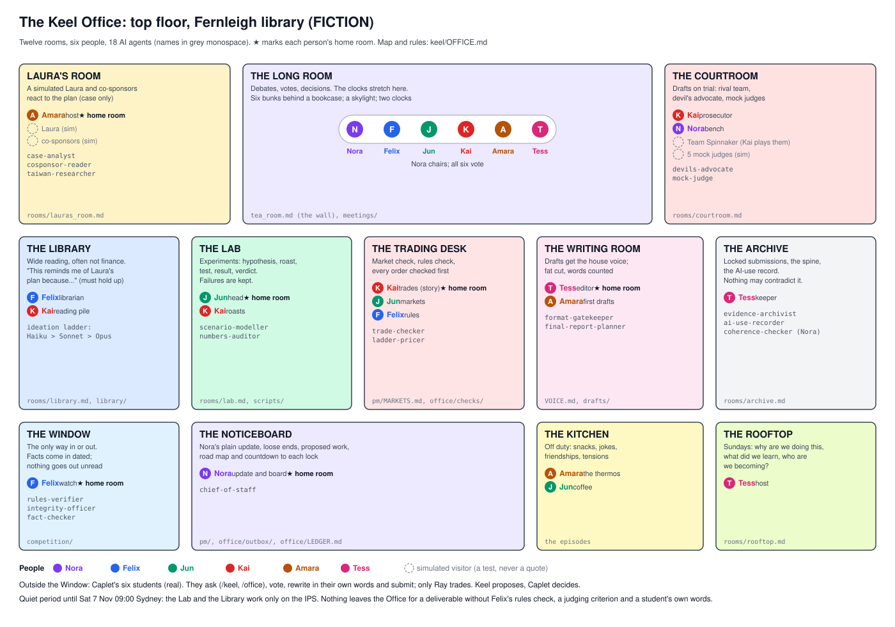

# FICTION (the rooms and people) + real work (what each room produces). Team Keel: the Office

> **Read `BIBLE.md` first: ten books (23-30 Oct 2026; Book 10 and the Ten Commandments, 30 Oct), under Wharton's word (`keel/WHARTON_WORD.md`), which ranks first.** They beat every rule on this page.
> Extraordinary above all; a distinctive, deeply human voice (Ahaan's, never AI's); one subtle motif, Caplet XR (extended
> release; X = 10; R never "release"); breathtaking investing knowledge, applied, not name-dropped; no hedging; and the
> IPS rewrite is slow, deep thinking, never rushed. No work is finished until the portal shows it.

> Ray approved the office on Fri 23 Oct 2026: one office made of rooms, with the Genius Lab and the Library added to the
> team's routine. This page is the map: which room does which job, who sits where, which AI agents work there and
> where each room keeps its files. Diagram: `office/office_map.svg`. Load this page instead of the older office
> pages when you need to know where something lives (`TOKEN_RULES.md`).

## One name for everything
**The Office** is the whole top floor of Fernleigh's library (`WORLD.md`). It replaces four older names, which now
mean one room each. No folder was moved, so every old path still works; the table says where each one went.

| Old name | Now | Path (unchanged) |
|---|---|---|
| Caplet Research Office (18 agents, 6 desks) | **The Office**; each desk became a room (below) | `office/`, `.claude/agents/` |
| Keel project office (board, loop, stand-ups) | **The Noticeboard** | `pm/` |
| The tea room (`tea_room.md`: plan, journal, open threads) | **The Long Room wall**; "tea room" now means **the Kitchen** | `tea_room.md` (file name kept so links don't break) |
| The Long Room | **The Long Room**, still the main room and still where the clocks stretch | `tea_room.md`, `meetings/` |
| The Window (`WORLD.md`) | **The Window**, the only way in or out of the Office | `competition/` |
| Desk: Rules & Integrity | The Window | |
| Desk: Numbers | The Genius Lab and the Trading Desk | |
| Desk: Strategy & Risk | The Courtroom and the Trading Desk | |
| Desk: Client & Co-sponsor | Laura's Room | |
| Desk: Judging & Editorial | The Writing Room, the Courtroom bench and the Archive | |
| Desk: Records | The Archive | |
| Chief of staff | The Noticeboard | |

## The twelve rooms
Each person has one **home room** (in bold) and visits others. Every agent sits in exactly one room and still works
for the member named in its file (`.claude/agents/<name>.md`, "Room" line).

| Room | Its job | Who sits there | AI agents there | Files |
|---|---|---|---|---|
| **The Long Room** | Debates, votes and decisions; the clocks stretch here (`WORLD.md`) | Nora chairs; all six vote | none: members speak for themselves | wall: `tea_room.md`; minutes: `meetings/` |
| **The Noticeboard** | Nora's plain update, loose ends, proposed work, the road map and countdown | **Nora** | `chief-of-staff` | `pm/` (BOARD, STANDUP, ROADMAP, RISKS, DECISIONS, PREMORTEMS, RETROS), `office/outbox/`, `office/LEDGER.md` |
| **The Window** | Everything from outside comes in here and nowhere else: Wharton files and emails, WInS snapshots, treasury.gov. Nothing goes out unread | **Felix** | `rules-verifier`, `integrity-officer`, `fact-checker` | `competition/`, `office/CHARTER.md`, log: `rooms/window.md` |
| **The Library** | Wide reading, often not finance (biology, history, cooking, sport, design). A reader brings back one "this reminds me of Laura's plan because..."; it stays only if it holds up | **Felix** (librarian), Kai (regular) and anyone who reads | none; the ideation ladder (Haiku, then Sonnet, then Opus) | slips: `rooms/library.md`; shelves (all research so far): `library/`; ladder method: `office/IDEATION.md` (PR #25) |
| **The Genius Lab** (renamed by Ray, 24 Oct) | As creative as possible: unexpected connections and a distinctive voice, every idea roasted and tested (hypothesis, Kai's roast, test, result, verdict: adopt, park or bin). Failures are kept. Charter: top of `rooms/lab.md` | **Jun** (head), Kai (roasts) | `scenario-modeller`, `numbers-auditor` | lab book: `rooms/lab.md`; write-ups: `rooms/lab/`; bench: `scripts/`; Final Report evidence lab: `routines/claude_lab/` |
| **The Trading Desk** | Jun's market check, Felix's rules check, every order checked before it is placed (in the story, only Kai trades; for Caplet, only Ray) | **Kai**, Jun (markets), Felix (rules) | `trade-checker`, `ladder-pricer` | `pm/MARKETS.md`, `office/checks/`, `routines/monitor_reports/`, `../competition/wins/` |
| **The Courtroom** | Drafts and plans on trial: a rival team, the devil's advocate and mock judges | Kai prosecutes; Nora on the bench; simulated: Team Spinnaker, five mock judges | `devils-advocate`, `mock-judge` | `rooms/courtroom.md`, `pm/PREMORTEMS.md`, `.claude/workflows/office-judge-panel` |
| **Laura's Room** | A simulated Laura and co-sponsors react to the plan, built only from the case | **Amara**; simulated: Laura, co-sponsors | `case-analyst`, `cosponsor-reader`, `taiwan-researcher` | `rooms/lauras_room.md` |
| **The Writing Room** | Drafts get the house voice (Ahaan's writing as the base); Tess cuts the fat and runs the counts | **Tess**, Amara (first drafts) | `format-gatekeeper`, `final-report-planner` | `VOICE.md`, `drafts/`, `office/tools/textcheck.py` |
| **The Archive** | Every locked submission word for word, the narrative spine, the AI-use record. Nothing new may contradict it | Tess | `evidence-archivist`, `ai-use-recorder`, `coherence-checker` (works for Nora) | `rooms/archive.md`, `office/LEDGER.md` |
| **The Kitchen** | Off duty: snacks, jokes, friendships, tensions; where some ideas slip out first | **Amara** keeps the thermos; everyone | none | the episodes; "Relationships right now" in `tea_room.md` |
| **The Rooftop** | Every two days (and Sundays), the big picture: why are we doing this, what have we learned, who are we becoming? | Tess hosts; everyone | none | `rooms/rooftop.md` |

Outside the Window: **Caplet's six students** (real). They ask questions (`/keel`, `/office`), vote, rewrite in their
own words and submit; only Ray trades. They never appear inside the Office as characters.

## Who sits where (by person)
| Member | Home room | Also works in | Agents who work for them (and their room) |
|---|---|---|---|
| Nora | The Noticeboard | Long Room (chair), Courtroom (bench) | `chief-of-staff` (Noticeboard), `mock-judge` (Courtroom), `coherence-checker` (Archive) |
| Felix | The Window | Library (librarian), Trading Desk (rules check) | `rules-verifier`, `integrity-officer`, `fact-checker` (Window) |
| Jun | The Genius Lab | Trading Desk (morning market check) | `scenario-modeller`, `numbers-auditor` (Genius Lab), `ladder-pricer` (Trading Desk) |
| Kai | The Trading Desk | Courtroom (prosecutor), Genius Lab (roasts), Library (brings his reading pile) | `trade-checker` (Trading Desk), `devils-advocate` (Courtroom) |
| Amara | Laura's Room | Writing Room (first drafts), Kitchen | `case-analyst`, `cosponsor-reader`, `taiwan-researcher` (Laura's Room) |
| Tess | The Writing Room | Archive (keeper), Rooftop (host) | `format-gatekeeper`, `final-report-planner` (Writing Room), `evidence-archivist`, `ai-use-recorder` (Archive) |

All 18 agents are placed: Noticeboard 1, Window 3, Trading Desk 2, Genius Lab 2, Courtroom 2, Laura's Room 3, Writing Room 2,
Archive 3.

## The rhythm
| When (Sydney) | Room | What happens | Routine |
|---|---|---|---|
| Daily 07:00 | Noticeboard, Library, Genius Lab | Nora works one board task; the Library adds at most one slip; the Genius Lab moves at most one experiment one step | `pm/routines/keel-daily-loop.md` |
| Tue-Sat 10:30 | Trading Desk, Window | Jun's market check; Felix's rules check | `pm/routines/keel-jun-markets.md` |
| Daily 20:00 | wherever the day happened | The episode; off-duty scenes in the Kitchen | `pm/routines/keel-daily-episode.md` |
| Sun 17:00 | Noticeboard, Courtroom, Rooftop | Week plan; Kai attacks the next deliverable; the Rooftop entry | `pm/routines/keel-weekly-plan.md` |
| Wed, Sat 18:00 | Archive | Records and AI-use log | `pm/routines/keel-tess-records.md` |
| A week before each deadline | Courtroom | Mock judges, after the humans have scored (`office/CHARTER.md` section 6) | `office-judge-panel` |

## House rules for the rooms (on top of `office/CHARTER.md` and `README.md`)
1. **Quiet period until Sat 7 Nov 09:00 Sydney** (when the IPS is in): the Genius Lab runs only IPS-relevant experiments on
   existing scripts and data; the Library reads only for the IPS pitch and framing and for the story. Anything else
   is queued with "waits for OK" until Ray approves it or the period ends.
2. **A winner has to earn its way out.** Nothing from the Genius Lab, the Library, the Courtroom or Laura's Room reaches a
   Caplet deliverable unless it passes Felix's rules check at the Window, maps to a judging criterion (Investment
   Strategy, Client Knowledge, Portfolio Analysis, Articulation of Competition Experience, Creativity &
   Presentation), fits the Archive's spine, and a Caplet student chooses it and writes it in their own words.
3. **Simulated people are labelled.** Laura, the co-sponsors, Team Spinnaker and the mock judges are simulations built
   only from official files. Their reactions are tests, never quotes; nothing they "say" goes into a deliverable as
   something a real person said.
4. **Fiction stays fiction.** Rooms, seats and scenes are story. What a room produces (a check, a number, a lab
   result) is real work, sourced and dated, and is logged in `office/LEDGER.md` when it informs Caplet.
