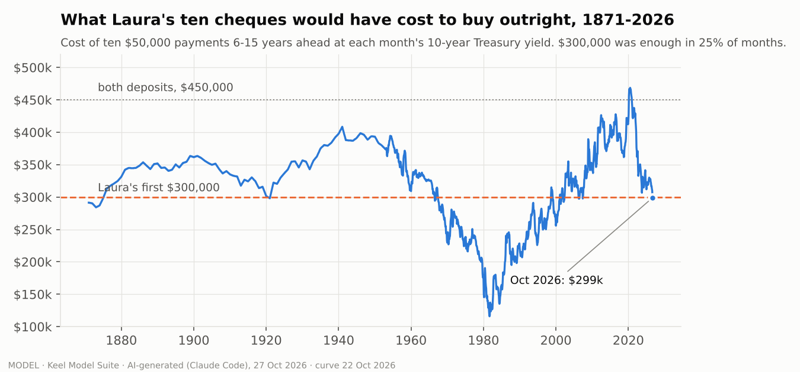
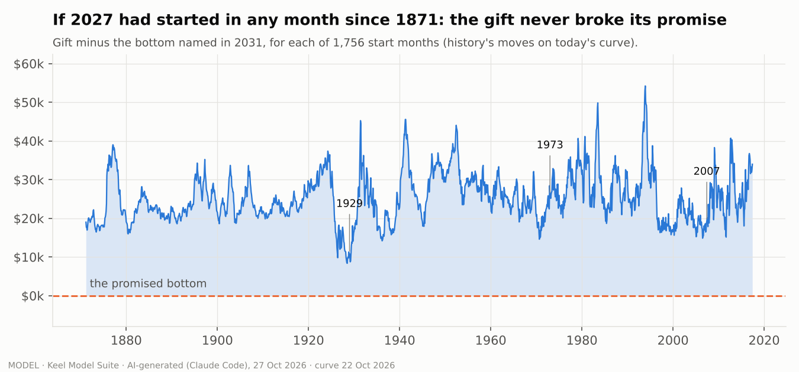
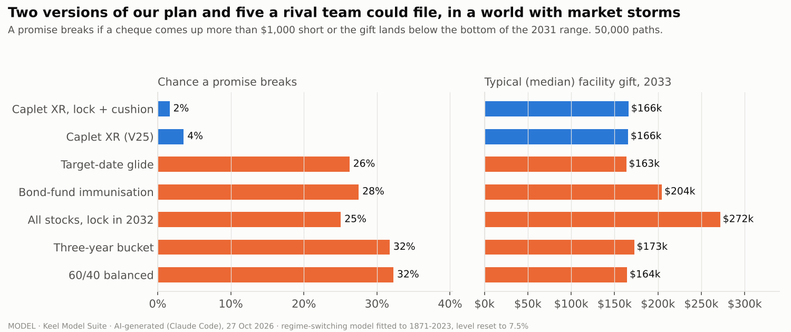
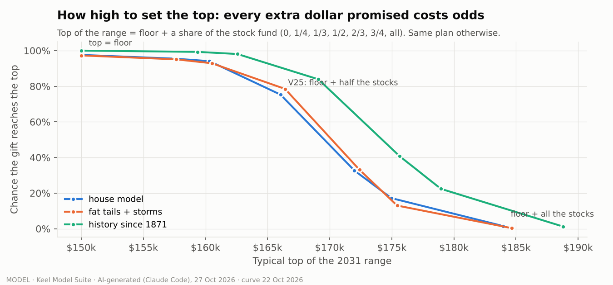
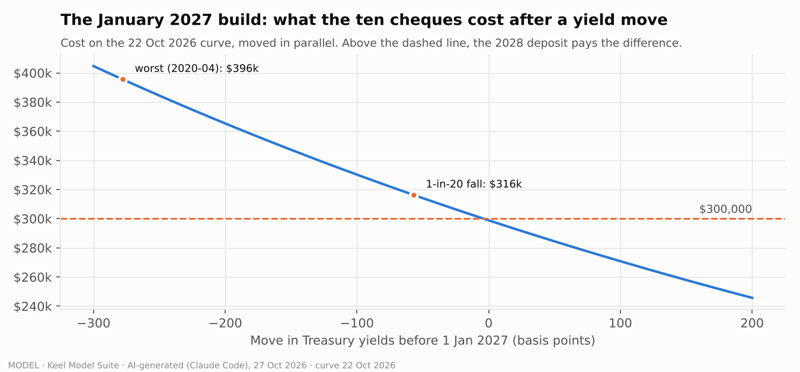
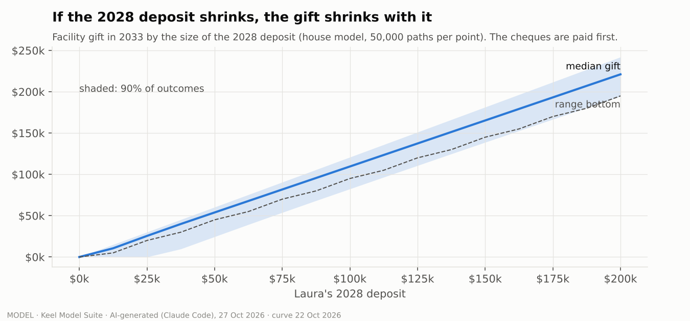
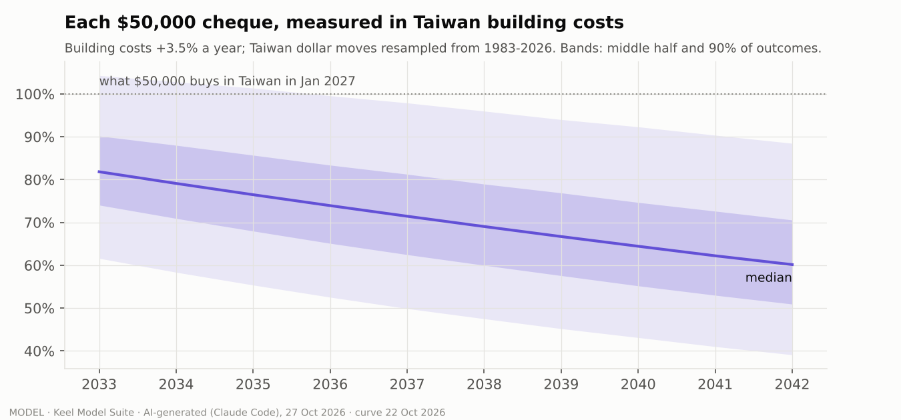

# The Model Suite: Caplet XR against 155 years, market storms and five rival plans

AI-generated (Claude Code) for Team Caplet, Tue 27 Oct 2026, at Ray's request ("i want more COMPUTER MODELS").
**MODEL, not a forecast or a promise.** Research for the IPS rewrite and the Final Report; nothing here is submission
text. STAMP: curve 22 Oct 2026 | J.P. Morgan 2027 global equities 7.5% compound, 16.78% vol | 50,000 paths per world |
history = Shiller monthly 1871-2023 (US stocks stand in for VT). Every assumption: [`ASSUMPTIONS.md`](ASSUMPTIONS.md).

**Run it:** `.venv/bin/python keel/models/run_suite.py` (numpy + matplotlib, ~3 minutes). Engine `xr_core.py` (Laura's
plan and five rivals on any market path), worlds `gens.py`, data `data/` ([sources](data/SOURCES.md)), numbers
`results/suite_results.json`, charts `charts/`.

## What it adds to the lab
The lab's models (`keel/library/ips_numbers_2026-10/ips_numbers.py`, L-10, R05, R08-R10) all live in one world: bell-curve
stocks and a random-walk yield. This suite runs the same plan, rule for rule, in **four more worlds** and against
**five rival plans**:

| World | What it is | Why it matters |
|---|---|---|
| House | lognormal stocks at 7.5%, yields a 1-point-a-year random walk | reconciles with the lab: V25's median gift $165k (L-10: $165.5k), top reached 75% (L-10: 77%) |
| Storms | a two-state regime model fitted to 152 years of stocks: calm months, and storms that start 1 month in 35, last ~6 months, fall 1.75% a month with fat (t, 5 df) tails and pull yields down 4bp a month | fat tails and crashes that cluster, which bell curves miss |
| Bootstrap | real months 1871-2023 resampled in two-year blocks, stocks + yields + inflation together | every crash keeps its own rates and prices |
| History | every start month since March 1871 (1,636 full 16-year paths; 1,756 for the 2031-33 window) | what would actually have happened |

Two versions of our plan are tested throughout: **V25 as written**, and **today's champion** (V25 + "lock what you
announce" in 2031 + the $7,500 cushion, rule G, from `keel/ips_rewrite/lab/R10_lock_cushion.py`).

## The findings, one IPS-ready number each

Book 7 says the IPS shows a decision framework, not calculations: it can carry one or two of these at most, as
reasons for a rule. The rest is Final Report evidence ("Portfolio Analysis: reasonable assumptions and projections
... under varying market outcomes").

| # | Model | Finding | IPS-ready number | Use |
|---|---|---|---|---|
| M1 | The price of certainty, 1871-2026 | Ten $50k cheques 6-15 years out cost under $300,000 only when the 10-year yield is above ~5.0% | **$300,000 could have bought all ten cheques in only one month in four since 1871, and in no month from mid-2007 until this autumn.** At the 2020 low they cost $469k, more than both deposits | **IPS** (why buy them now, not later: certainty is on sale) |
| M1b | Plan replay, every month since 1871 | Neither version of our plan ever bounced a cheque or landed the gift below its bottom; the closest call was a 1928-29 start, still $8,400 (V25) / $3,100 (champion) above the bottom [Window 28 Oct: not in suite_results.json; the file shows the 1929-01 start $10,870 above, and the worst gift in the range window $104,632 (2008-12 start). Re-derive before use] | **0 broken promises in 1,756 historical starts**; top reached 84% (V25), 97% (champion) | Final Report; IPS only as "tested against every month since 1871" |
| M2 | Storms and fat tails | Storms move the stock fund, not the cheques: V25's 1-in-20 gift goes $138.8k -> $138.0k; a 60/40 plan's chance of a short cheque goes 6.1% -> 7.6% | **Fat tails cost our gift under $1,000 at the 1-in-20 line** | Final Report |
| M3 | The January 2027 build | Headroom is 3.8bp. Each 0.1 point fall in yields before 1 Jan moves ~$3,000 of the deposit from the gift to the cheques. A 1-in-20 two-month fall (-0.57pt, 1953-2026) costs $16k; the worst (Feb-Apr 2020, scaled) $96k, still inside the $150k deposit | **V25's break point checks out:** yields -2pt need $65k of the deposit, so a cheque breaks only if the deposit also falls by more than ~56% ("more than halves" is right, with a little to spare) [Window 28 Oct: covers the Jan 2027 gap only ($65,335). K07 T7, same engine, -2pt: about $85k of the deposit is needed with the coupon rule ($75k still leaves 1.5% short), so the break is nearer "falls by more than ~43%". Use K07's figure] | IPS (keeps the break-point sentence honest) |
| M4 | Inflation and the Taiwan dollar | At 3.5% Taiwan building inflation the 2042 cheque buys ~60% of what $50,000 buys today (1-in-20: 39%); a 1966 or 1973 replay leaves it 37% in US prices. Topping all ten back up would need ~$177k on 1 Jan 2033 (median) against ~$26k Laura keeps | **Laura's kept half covers a full inflation top-up in only ~5% of worlds (21% at 2% inflation)**: it is a cushion, not inflation insurance | IPS: fix V25's "the project's second cheque" claim (see below) |
| M5 | The 2028 deposit, $0-$200k | Every dollar the deposit falls short comes off the gift, almost one for one; the cheques are untouched while it covers the Jan 2027 gap. But a smaller deposit means a smaller kept half, so V25's coupon-gap risk climbs (2% at $150k, 7.5% at $50k) unless the cushion rule holds money back | **With a coverage rule (L-10's $10k test) the cheques stay whole down to a ~$40k deposit**; without one they don't | IPS (one more reason for the cushion rule) |
| M6 | How high to set the top | The top "floor + half the stocks" is reached ~3 times in 4 (house 75%, storms 79%, history 84%); two-thirds collapses it to ~1 in 3: a cliff, because the gift only ever owns half the stocks (here only the quoted top moves; if the pledged share moves with it, as in WO-R8 idea 1, the odds hold) | **Odds 3:1 (house), 3.6:1 (storms), 5:1 (history) at the V25 top** | IPS (backs "about three times in four" and the 3:1 cost ratio) |
| M7 | Five rival plans | Every rival plan breaks one of Laura's two promises 22-36% of the time (17-24% if it quotes +/-40%), mostly by landing below its own range; the lock-late plan gets the biggest median gift ($254-325k) but bounces a cheque in 6-11% of worlds | **Our champion breaks a promise in 0-1.6% of worlds, depending on the world; the rival plans in 22-36%** | Final Report; IPS at most "every plan we tested that keeps stocks in the pot broke a promise about one time in four" |
| M8 | Sequence risk (the sceptic's paragraph) | Start the plan in January 1923: stocks return ~7% a year over the next fifteen years and still beat bonds, yet a 60/40 pot runs dry and bounces the last two cheques (1937, 1938) | **"Stocks won the decade and the cheques still bounced"** | IPS (one clause, as proof that "ten one-year bills" is not one ten-year bill) |

## The charts

## The rival scoreboard (M7)
"Short" = a cheque more than $1,000 short. "Below" = the 2033 gift lands below the bottom named in 2031. Gift = median.
Laura 2042 = what she still owns after the last cheque (median): the flexibility number.

| Plan | Storms: short / below / gift / Laura 2042 | History since 1871: short / below / gift / Laura 2042 |
|---|---|---|
| **Caplet XR, lock + cushion (champion)** | 0.2% / 1.6% / $166k / $31k | 0% / 0% / $169k / $34k |
| **Caplet XR, V25 as written** | 2.1% / 1.6% / $166k / $47k | 0% / 0% / $168k / $56k |
| Target-date glide (80% -> 30% stocks) | 3.9% / 23% / $163k / $196k | 0.5% / 24% / $184k / $221k |
| Bond-fund immunisation (IEF/TLT) | 12.9% / 17% / $204k / $42k | 11.1% / 18% / $211k / $43k |
| All stocks, buy the ladder in 2032 | 11.0% / 18% / $272k / $0 | 6.8% / 20% / $305k / $0 |
| Three-year bucket | 6.6% / 27% / $173k / $171k | 1.8% / 30% / $193k / $204k |
| 60/40 balanced | 7.6% / 27% / $164k / $229k | 1.3% / 28% / $181k / $285k |

All five worlds are in `results/suite_results.json` (house, storms, bootstrap at 7.5%, bootstrap raw, history). With a
+/-40% range instead of +/-20% the rivals still break a promise 17-24% of the time in the storm world.

**What the scoreboard does not flatter:** the 60/40, glide and bucket plans leave Laura far more money in 2042
($170-290k vs our $31-56k), because they hold back the cheques' full face value and let it grow. They pay for that with
a $0 gift in 1 model world in 20 and a broken range about 1 time in 4. Our plan spends its certainty on the cheques and the gift; Laura's
flexibility is the thinnest of our numbers, and the IPS should say so in its own terms (her half of the stocks, hers
to sell any day), not hide it.

## What this means for the rewrite (Keel's calls, logged)
1. **New aha for the "why buy them" line (M1).** Nobody else will have it: the cheques are cheap enough to buy only
   in one month in four of US history, and this is the first such window since 2007. It turns "we would rather buy
   them" from caution into timing. Candidate raw line (not draft text): "For the first time since 2007, $300,000 buys
   all ten." Check: on the 22 Oct curve it does, by $1,139; the IBTR trade note already conditions it.
2. **V25's inflation sentence overclaims (M4).** "Half the stocks stay Laura's ... the project's second cheque" reads
   as if her half protects the cheques' buying power. It covers a full top-up in ~5% of worlds. Keep the true part
   ("Inflation can make $50,000 buy less. It cannot make $50,000 cost more."), and make the kept half what it is:
   flexibility for the project, not insurance against the building's prices.
3. **The cushion rule is not optional (M5, M7).** V25 as written bounces a cheque in ~2% of house-model worlds; with the
   lock + cushion it is 0.2%. It also holds when the 2028 deposit shrinks.
4. **The sceptic paragraph gets its proof (M8).** 1923 is the Final Report's exhibit; in the IPS, one clause at most.
5. **The 3:1 range ratio is conservative (M6).** History gives 5:1 at the same top; the storm world 3.6:1. The lock
   (R08-R10) lifts the top's odds to 84-97%.

## Reconciliation with the lab
| Number (house world, V25) | This suite | Lab | Why they differ |
|---|---|---|---|
| Median gift | $165,254 | L-10 S0: $165,528 | same rules, different seeds and monthly vs semiannual steps |
| Top reached | 75.3% | L-10: 76.7% | as above |
| Below the bottom | 1.3% | L-10: 0.75% | as above; both "about 1 in 100" |
| Champion: top reached / below bottom | 84.1% / 1.3% | R10 G: 86.7% / 0.75% | |
| Champion: cheques short | 0.19% | R10 G: 1.05% | R10 counts the gap above the set-aside with no backstop; we let Laura's kept stocks pay it (A17) |
| Ladder cost 1 Jan 2027 | $298,861 | the Window, 26 Oct: $298,861 | identical method |

## Limits
US stocks stand in for VT before 1983 and are kinder than the world was (A07). Shiller's pre-1953 yields move too
smoothly month to month (A34). Yields move in parallel on today's curve (A02). Rival plans are Keel's archetypes, not
real filings (A20). Taiwan's building-cost inflation is an assumption (A40), not a downloaded series.
